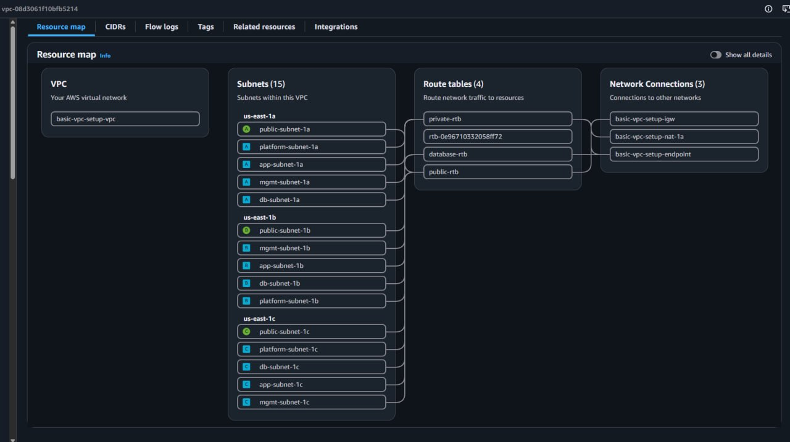

# DevOpsCube Project 7: Design an AWS VPC Based on Application Architecture

## Executive Summary & Architecture Overview

Modern enterprise cloud infrastructure requires strict isolation, high availability, and deterministic routing paths. As a DevOps engineer, designing a Virtual Private Cloud (VPC) involves creating a resilient network topology that balances robust security boundaries with operational efficiency.

This implementation guide outlines the deployment of a highly available, multi-tier enterprise VPC infrastructure spanning three Availability Zones (us-east-1a, us-east-1b, and us-east-1c).

AWS REGION (us-east-1)

┌─────────────────────────────────────────────────────────────────────────────┐

│ VPC: 10.0.0.0/16                                                            │

│                                                                             │

│  ┌───────────────────────┐ ┌───────────────────────┐ ┌───────────────────┐  │

│  │      AZ: us-east-1a   │ │      AZ: us-east-1b   │ │   AZ: us-east-1c  │  │

│  │                       │ │                       │ │                   │  │

│  │  ┌─────────────────┐  │ │  ┌─────────────────┐  │ │  ┌─────────────┐  │  │

│  │  │ Public Subnet   │  │ │  │ Public Subnet   │  │ │  │ Public Subnet│  │  │

│  │  │ 10.0.1.0/24     │  │ │  │ 10.0.2.0/24     │  │ │  │ 10.0.3.0/24 │  │  │

│  │  └────────┬────────┘  │ │  └────────┬────────┘  │ │  └──────┬──────┘  │  │

│  └───────────┼───────────┘ └───────────┼───────────┘ └─────────┼─────────┘  │

│              │                         │                       │            │

│              ▼                         ▼                       ▼            │

│  ┌───────────────────────┐ ┌───────────────────────┐ ┌───────────────────┐  │

│  │ App Subnet 10.0.4.0/24│ │ App Subnet 10.0.5.0/24│ │ App 10.0.6.0/24   │  │

│  ├───────────────────────┤ ├───────────────────────┤ ├───────────────────┤  │

│  │ DB Subnet  10.0.7.0/24│ │ DB Subnet  10.0.8.0/24│ │ DB  10.0.9.0/24   │  │

│  ├───────────────────────┤ ├───────────────────────┤ ├───────────────────┤  │

│  │ Mgmt Subnet 10.0.10.0 │ │ Mgmt Subnet 10.0.11.0 │ │ Mgmt 10.0.12.0    │  │

│  ├───────────────────────┤ ├───────────────────────┤ ├───────────────────┤  │

│  │ Platform 10.0.13.0/24 │ │ Platform 10.0.14.0/24 │ │ Platform 10.0.15.0│  │

│  └───────────────────────┘ └───────────────────────┘ └───────────────────┘  │

└─────────────────────────────────────────────────────────────────────────────┘

## Final Topology Map



> Route tables in the guide as written: **3 total** — `public-rtb`, `private-rtb`, and `database-rtb`. The subnet IP plan labels them `Private (NAT-A/B/C)`, but the cost-optimized path (Phase 4 + Phase 5 as written) deploys a **single shared NAT Gateway** (`basic-vpc-setup-nat-1a` in `public-subnet-1a`) and **one shared `private-rtb`** for all 9 private/management/platform subnets. For Production HA instead, deploy 3 NAT Gateways (one per AZ) and create 3 separate private route tables (`private-rtb-1a`, `private-rtb-1b`, `private-rtb-1c`), each pointing at its own AZ's NAT — giving 5 route tables total.

- **Public / Web Tier:** Hosts Internet-facing Application Load Balancers (ALB) and public ingress points. Direct Internet accessibility is provided via an Internet Gateway (IGW).
- **Application Tier:** Contains private compute resources executing backend microservices and Java applications. Outbound connectivity is strictly proxied through NAT Gateways.
- **Database Tier:** Contains isolated data stores (Amazon RDS MySQL). Isolated by dedicated Network Access Control Lists (NACLs) preventing direct Internet ingress or egress.
- **Management Tier:** Houses CI/CD automation nodes, self-hosted runners, administrative bastion hosts, and operational tooling.
- **Platform Services Tier:** Dedicated private space for shared observability, service discovery, and configuration management infrastructure (Prometheus, Grafana, HashiCorp Consul).

## IPv4 CIDR Allocation Strategy

The base network address space is assigned 10.0.0.0/16 (65,536 available addresses). The network is sliced into contiguous /24 subnets (254 usable IPs per subnet) across 3 Availability Zones to ensure fault tolerance and predictable IP address management (IPAM).

## Complete Subnet & IP Plan Table

| Tier        | Subnet Name        | CIDR Block   | Availability Zone | Route Table Type  | Primary Workloads             |
| ----------- | ------------------ | ------------ | ----------------- | ----------------- | ----------------------------- |
| Public      | public-subnet-1a   | 10.0.1.0/24  | us-east-1a        | Public (IGW)      | ALBs, NAT Gateway A, Bastion  |
| Public      | public-subnet-1b   | 10.0.2.0/24  | us-east-1b        | Public (IGW)      | ALBs, NAT Gateway B           |
| Public      | public-subnet-1c   | 10.0.3.0/24  | us-east-1c        | Public (IGW)      | ALBs, NAT Gateway C           |
| Application | app-subnet-1a      | 10.0.4.0/24  | us-east-1a        | Private (NAT-A)   | Java Web Apps, Microservices  |
| Application | app-subnet-1b      | 10.0.5.0/24  | us-east-1b        | Private (NAT-B)   | Java Web Apps, Microservices  |
| Application | app-subnet-1c      | 10.0.6.0/24  | us-east-1c        | Private (NAT-C)   | Java Web Apps, Microservices  |
| Database    | db-subnet-1a       | 10.0.7.0/24  | us-east-1a        | Isolated (No NAT) | RDS MySQL Primary             |
| Database    | db-subnet-1b       | 10.0.8.0/24  | us-east-1b        | Isolated (No NAT) | RDS MySQL Standby             |
| Database    | db-subnet-1c       | 10.0.9.0/24  | us-east-1c        | Isolated (No NAT) | RDS MySQL Read Replica        |
| Management  | mgmt-subnet-1a     | 10.0.10.0/24 | us-east-1a        | Private (NAT-A)   | Jenkins Controllers, Runners  |
| Management  | mgmt-subnet-1b     | 10.0.11.0/24 | us-east-1b        | Private (NAT-B)   | CI/CD Build Agents            |
| Management  | mgmt-subnet-1c     | 10.0.12.0/24 | us-east-1c        | Private (NAT-C)   | Deployment Gateways           |
| Platform    | platform-subnet-1a | 10.0.13.0/24 | us-east-1a        | Private (NAT-A)   | Prometheus, Grafana           |
| Platform    | platform-subnet-1b | 10.0.14.0/24 | us-east-1b        | Private (NAT-B)   | HashiCorp Consul Cluster      |
| Platform    | platform-subnet-1c | 10.0.15.0/24 | us-east-1c        | Private (NAT-C)   | Logging & Tracing Aggregators |

## Step-by-Step Manual Implementation Guide in AWS Management Console

### Phase 1: Create the VPC

Navigate to the AWS Management Console → VPC Dashboard.

Click Create VPC.

Select VPC only.

Configure the settings:

- Name tag: basic-vpc-setup-vpc
- IPv4 CIDR block: Manual CIDR input → 10.0.0.0/16
- IPv6 CIDR block: No IPv6 CIDR block
- Tenancy: Default

Click Create VPC.

Select the newly created VPC, click Actions → Edit VPC settings.

Select Enable DNS hostnames and Enable DNS resolution. Click Save changes.

### Phase 2: Create Subnets

In the left navigation pane, select Subnets → Create subnet.

Select VPC ID: basic-vpc-setup-vpc.

Iteratively create all 15 subnets using the parameters from the Subnet & IP Plan Table. Ensure precise naming, correct AZ mapping (us-east-1a, us-east-1b, us-east-1c), and explicit IPv4 CIDR blocks.

Post-Creation Configuration: Select each of the 3 Public Subnets (public-subnet-1a, public-subnet-1b, public-subnet-1c), click Actions → Edit subnet settings, check Enable auto-assign public IPv4 address, and save.

### Phase 3: Internet Gateway (IGW)

Select Internet gateways in the VPC Dashboard → Create internet gateway.

Enter Name tag: basic-vpc-setup-igw. Click Create internet gateway.

Select basic-vpc-setup-igw → Actions → Attach to VPC.

Select basic-vpc-setup-vpc and click Attach internet gateway.

### Phase 4: NAT Gateway Setup

Select NAT gateways → Create NAT gateway.

Configure settings:

- Name: basic-vpc-setup-nat-1a
- Subnet: Select public-subnet-1a
- Connectivity type: Public
- Elastic IP allocation ID: Click Allocate Elastic IP

Click Create NAT gateway.

Cost Optimization Note: For production high availability, deploy one NAT Gateway per AZ (3 total). For sandbox/dev environments, a single NAT Gateway located in public-subnet-1a can be shared across all private route tables to significantly minimize hourly AWS data processing charges.

### Phase 5: Route Tables Configuration

Select Route tables → Create route table.

Create Public Route Table:

- Name: public-rtb
- VPC: basic-vpc-setup-vpc
- Routes Configuration: Edit routes → Add route: 0.0.0.0/0 targeting Internet Gateway (basic-vpc-setup-igw).
- Subnet Associations: Associate public-subnet-1a, public-subnet-1b, public-subnet-1c.

Create Private Route Table:

- Name: private-rtb
- VPC: basic-vpc-setup-vpc
- Routes Configuration: Edit routes → Add route: 0.0.0.0/0 targeting NAT Gateway (basic-vpc-setup-nat-1a).
- Subnet Associations: Associate all Application, Management, and Platform subnets (9 subnets total).

Create Database Route Table:

- Name: database-rtb
- VPC: basic-vpc-setup-vpc
- Routes Configuration: Retain local route 10.0.0.0/16 only (no internet egress).
- Subnet Associations: Associate db-subnet-1a, db-subnet-1b, db-subnet-1c.

### Phase 6: Custom Database Network ACL (NACL) Configuration

Select Network ACLs → Create network ACL.

Name: db-tier-nacl, VPC: basic-vpc-setup-vpc.

Associate this NACL with db-subnet-1a, db-subnet-1b, and db-subnet-1c.

Configure Inbound Rules:

| Rule # | Type        | Protocol | Port Range | Source CIDR | Allow / Deny | Purpose                          |
| ------ | ----------- | -------- | ---------- | ----------- | ------------ | -------------------------------- |
| 100    | Custom TCP  | TCP      | 3306       | 10.0.4.0/24 | ALLOW        | MySQL Ingress from App Subnet 1a |
| 110    | Custom TCP  | TCP      | 3306       | 10.0.5.0/24 | ALLOW        | MySQL Ingress from App Subnet 1b |
| 120    | Custom TCP  | TCP      | 3306       | 10.0.6.0/24 | ALLOW        | MySQL Ingress from App Subnet 1c |
| *      | ALL Traffic | ALL      | ALL        | 0.0.0.0/0   | DENY         | Explicit Default Deny            |

Configure Outbound Rules:

| Rule # | Type | Protocol | Port Range | Destination CIDR | Allow / Deny | Purpose |
|---|---|---|---|---|---|---|
| 100 | Custom TCP | TCP | 1024–65535 | 10.0.4.0/24 | ALLOW | Return Ephemeral Traffic to App 1a |
| 110 | Custom TCP | TCP | 1024–65535 | 10.0.5.0/24 | ALLOW | Return Ephemeral Traffic to App 1b |
| 120 | Custom TCP | TCP | 1024–65535 | 10.0.6.0/24 | ALLOW | Return Ephemeral Traffic to App 1c |
| * | ALL Traffic | ALL | ALL | 0.0.0.0/0 | DENY | Explicit Default Deny |

### Phase 7: VPC Gateway Endpoint for Amazon S3

Select Endpoints → Create endpoint.

- Service category: AWS services.
- Service Name: Search com.amazonaws.us-east-1.s3, select type Gateway.
- VPC: basic-vpc-setup-vpc.
- Route Tables: Select private-rtb and database-rtb.
- Policy: Full Access (or custom restricted IAM policy).

Click Create endpoint.

Benefit: Private workload traffic destined for Amazon S3 traverses internal AWS network backbones directly, entirely bypassing NAT Gateways. This reduces egress traffic charges and increases throughput.

## Manual AWS Console Teardown Order

Due to strict cloud dependency chains enforced by the AWS Control Plane, resources must be deleted in exact reverse order of creation. Attempting to delete a parent resource while child components are bound to it will trigger dependency errors (e.g., DependencyViolation).

DELETION ORDER (REVERSE DEPENDENCIES)

┌─────────────────┐       ┌─────────────────┐       ┌─────────────────┐
│  NAT Gateways   │ ────> │   Elastic IPs   │ ────> │  VPC Endpoints  │
└─────────────────┘       └─────────────────┘       └─────────────────┘
           │                                                 │
           ▼                                                 ▼
┌─────────────────┐       ┌─────────────────┐       ┌─────────────────┐
│ Custom NACLs /  │ ────> │     Subnets     │ ────> │  Route Tables   │
│ Security Groups │       └─────────────────┘       └─────────────────┘
└─────────────────┘                                                 │
                                                                   ▼
┌─────────────────┐       ┌─────────────────┐       ┌─────────────────┐
│   VPC Delete    │ <──── │ Detach & Delete │ <──── │ Detach Subnets  │
│  (Final Step)   │       │ Internet Gateway│       │   from Routes   │
└─────────────────┘       └─────────────────┘       └─────────────────┘

Execution Steps:

1. Delete NAT Gateways: Delete basic-vpc-setup-nat-1a and wait for status to change from Deleting to Deleted.
2. Release Elastic IPs: Release the EIP previously attached to the NAT Gateway once it is fully disassociated.
3. Delete VPC Endpoints: Delete the S3 Gateway Endpoint.
4. Delete Subnets: Delete all 15 subnets simultaneously or sequentially once network interfaces are detached.
5. Delete Custom Route Tables & NACLs: Delete public-rtb, private-rtb, database-rtb, and db-tier-nacl.
6. Detach & Delete Internet Gateway: Detach basic-vpc-setup-igw from basic-vpc-setup-vpc, then delete it.
7. Delete VPC: Delete basic-vpc-setup-vpc.

## Terraform IaC Implementation & Terraform Destroy

### Understanding Infrastructure State Management

Terraform maintains a state file (terraform.tfstate) that maps real-world infrastructure objects to configuration declarations. The terraform destroy command functions by evaluating the state file dependencies and executing targeted Delete calls in reverse order.

Important: If infrastructure was provisioned manually via the AWS Console, running terraform destroy will not remove those manual resources. Terraform can only manage and destroy infrastructure created by Terraform or explicitly imported using the terraform import command.

### Complete Copy-Pasteable Terraform Code

#### variables.tf

```hcl
variable "aws_region" {
  type        = string
  default     = "us-east-1"
  description = "Target AWS Region"
}

variable "vpc_cidr" {
  type        = string
  default     = "10.0.0.0/16"
  description = "Base VPC CIDR block"
}

variable "availability_zones" {
  type        = list(string)
  default     = ["us-east-1a", "us-east-1b", "us-east-1c"]
  description = "Target availability zones"
}
```

#### main.tf

```hcl
terraform {
  required_version = ">= 1.5.0"
  required_providers {
    aws = {
      source  = "hashicorp/aws"
      version = "~> 5.0"
    }
  }
}

provider "aws" {
  region = var.aws_region
}

# 1. VPC Creation

resource "aws_vpc" "main" {
  cidr_block           = var.vpc_cidr
  enable_dns_hostnames = true
  enable_dns_support   = true
  tags = {
    Name         = "basic-vpc-setup-vpc"
    Environment  = "Production"
    EngineeredBy = "Terraform"
  }
}

# 2. Internet Gateway

resource "aws_internet_gateway" "igw" {
  vpc_id = aws_vpc.main.id
  tags = {
    Name = "basic-vpc-setup-igw"
  }
}

# 3. Subnets Configuration

# Public Subnets

resource "aws_subnet" "public" {
  count                   = 3
  vpc_id                  = aws_vpc.main.id
  cidr_block              = "10.0.${count.index + 1}.0/24"
  availability_zone       = var.availability_zones[count.index]
  map_public_ip_on_launch = true
  tags = {
    Name = "public-subnet-${element(["1a", "1b", "1c"], count.index)}"
    Tier = "Public"
  }
}

# Application Subnets

resource "aws_subnet" "app" {
  count             = 3
  vpc_id            = aws_vpc.main.id
  cidr_block        = "10.0.${count.index + 4}.0/24"
  availability_zone = var.availability_zones[count.index]
  tags = {
    Name = "app-subnet-${element(["1a", "1b", "1c"], count.index)}"
    Tier = "Application"
  }
}

# Database Subnets

resource "aws_subnet" "db" {
  count             = 3
  vpc_id            = aws_vpc.main.id
  cidr_block        = "10.0.${count.index + 7}.0/24"
  availability_zone = var.availability_zones[count.index]
  tags = {
    Name = "db-subnet-${element(["1a", "1b", "1c"], count.index)}"
    Tier = "Database"
  }
}

# Management Subnets

resource "aws_subnet" "mgmt" {
  count             = 3
  vpc_id            = aws_vpc.main.id
  cidr_block        = "10.0.${count.index + 10}.0/24"
  availability_zone = var.availability_zones[count.index]
  tags = {
    Name = "mgmt-subnet-${element(["1a", "1b", "1c"], count.index)}"
    Tier = "Management"
  }
}

# Platform Subnets

resource "aws_subnet" "platform" {
  count             = 3
  vpc_id            = aws_vpc.main.id
  cidr_block        = "10.0.${count.index + 13}.0/24"
  availability_zone = var.availability_zones[count.index]
  tags = {
    Name = "platform-subnet-${element(["1a", "1b", "1c"], count.index)}"
    Tier = "Platform"
  }
}

# 4. Elastic IP & NAT Gateway

resource "aws_eip" "nat" {
  domain     = "vpc"
  depends_on = [aws_internet_gateway.igw]
  tags = {
    Name = "basic-vpc-setup-nat-eip"
  }
}

resource "aws_nat_gateway" "nat" {
  allocation_id = aws_eip.nat.id
  subnet_id     = aws_subnet.public[0].id
  tags = {
    Name = "basic-vpc-setup-nat-1a"
  }
}

# 5. Route Tables & Associations

# Public Route Table

resource "aws_route_table" "public" {
  vpc_id = aws_vpc.main.id
  route {
    cidr_block = "0.0.0.0/0"
    gateway_id = aws_internet_gateway.igw.id
  }
  tags = {
    Name = "public-rtb"
  }
}

resource "aws_route_table_association" "public" {
  count          = 3
  subnet_id      = aws_subnet.public[count.index].id
  route_table_id = aws_route_table.public.id
}

# Private Route Table

resource "aws_route_table" "private" {
  vpc_id = aws_vpc.main.id
  route {
    cidr_block     = "0.0.0.0/0"
    nat_gateway_id = aws_nat_gateway.nat.id
  }
  tags = {
    Name = "private-rtb"
  }
}

resource "aws_route_table_association" "app" {
  count          = 3
  subnet_id      = aws_subnet.app[count.index].id
  route_table_id = aws_route_table.private.id
}

resource "aws_route_table_association" "mgmt" {
  count          = 3
  subnet_id      = aws_subnet.mgmt[count.index].id
  route_table_id = aws_route_table.private.id
}

resource "aws_route_table_association" "platform" {
  count          = 3
  subnet_id      = aws_subnet.platform[count.index].id
  route_table_id = aws_route_table.private.id
}

# Database Route Table (Isolated)

resource "aws_route_table" "db" {
  vpc_id = aws_vpc.main.id
  tags = {
    Name = "database-rtb"
  }
}

resource "aws_route_table_association" "db" {
  count          = 3
  subnet_id      = aws_subnet.db[count.index].id
  route_table_id = aws_route_table.db.id
}

# 6. Network ACL for Database Tier

resource "aws_network_acl" "db" {
  vpc_id     = aws_vpc.main.id
  subnet_ids = aws_subnet.db[*].id

  # Inbound Rules
  ingress {
    rule_no    = 100
    action     = "allow"
    cidr_block = "10.0.4.0/24"
    from_port  = 3306
    to_port    = 3306
    protocol   = "tcp"
  }
  ingress {
    rule_no    = 110
    action     = "allow"
    cidr_block = "10.0.5.0/24"
    from_port  = 3306
    to_port    = 3306
    protocol   = "tcp"
  }
  ingress {
    rule_no    = 120
    action     = "allow"
    cidr_block = "10.0.6.0/24"
    from_port  = 3306
    to_port    = 3306
    protocol   = "tcp"
  }

  # Outbound Rules
  egress {
    rule_no    = 100
    action     = "allow"
    cidr_block = "10.0.4.0/24"
    from_port  = 1024
    to_port    = 65535
    protocol   = "tcp"
  }
  egress {
    rule_no    = 110
    action     = "allow"
    cidr_block = "10.0.5.0/24"
    from_port  = 1024
    to_port    = 65535
    protocol   = "tcp"
  }
  egress {
    rule_no    = 120
    action     = "allow"
    cidr_block = "10.0.6.0/24"
    from_port  = 1024
    to_port    = 65535
    protocol   = "tcp"
  }

  tags = {
    Name = "db-tier-nacl"
  }
}

# 7. VPC Endpoint for S3

resource "aws_vpc_endpoint" "s3" {
  vpc_id            = aws_vpc.main.id
  service_name      = "com.amazonaws.${var.aws_region}.s3"
  vpc_endpoint_type = "Gateway"
  route_table_ids = [
    aws_route_table.private.id,
    aws_route_table.db.id
  ]
  tags = {
    Name = "s3-vpc-endpoint"
  }
}
```

#### outputs.tf

```hcl
output "vpc_id" {
  value       = aws_vpc.main.id
  description = "The ID of the provisioned VPC"
}

output "public_subnet_ids" {
  value       = aws_subnet.public[*].id
  description = "List of Public Subnet IDs"
}

output "app_subnet_ids" {
  value       = aws_subnet.app[*].id
  description = "List of Application Subnet IDs"
}

output "db_subnet_ids" {
  value       = aws_subnet.db[*].id
  description = "List of Database Subnet IDs"
}

output "nat_gateway_public_ip" {
  value       = aws_eip.nat.public_ip
  description = "Public Elastic IP assigned to the NAT Gateway"
}
```

## Step-by-Step Command Execution

Execute the following commands in the terminal directory containing your .tf files:

1. Initialize Working Directory

Downloads provider plugins (AWS) and sets up the local .terraform directory.

```bash
terraform init
```

2. Dry-Run Execution Plan

Generates and displays an execution plan, allowing you to review the 31 planned additions without making infrastructure changes.

```bash
terraform plan
```

3. Apply Configuration

Provisions all VPC resources directly to your AWS Account.

```bash
terraform apply -auto-approve
```

4. Automated Infrastructure Teardown

Deletes all provisioned infrastructure in the exact reverse-dependency sequence safely.

```bash
terraform destroy -auto-approve
```